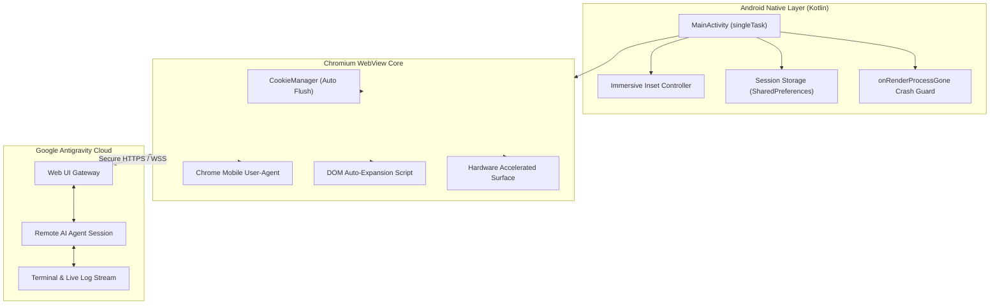
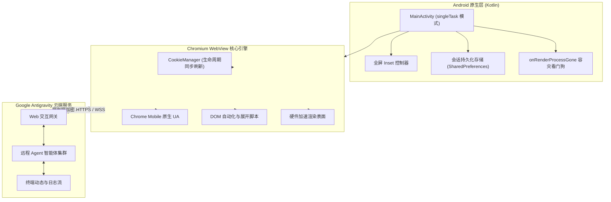

<div align="center">

# 🚀 Antigravity Mobile

**Ultra-immersive, zero-compromise native Android companion for Google Antigravity remote agent sessions.**  
**Google Antigravity 远程智能体 (Agent) 会话的极致沉浸原生 Android 伴侣。**

[](LICENSE)
[-3DDC84?logo=android&logoColor=white)](https://developer.android.com)
[](https://kotlinlang.org)
[](https://adoptium.net)
[](#building-from-source)
[](CONTRIBUTING.md)

[English](#english) • [简体中文](#简体中文)

</div>

---

<a name="english"></a>
## 🌐 English

### 📖 What is Antigravity Mobile?

**Antigravity Mobile** is a specialized native Android application designed to provide a distraction-free, OLED-optimized mobile interface for **Google Antigravity** cloud and remote agent sessions.

While Google Antigravity powers advanced multi-agent coding workflows on desktop and cloud environments, inspecting running agents, reviewing streaming terminal output, and chatting with agents while away from your workstation often requires clumsy mobile browser tabs burdened by URL bars, tabs, accidental reloads, and desktop-first promotional screens.

Antigravity Mobile bridges this gap by packaging an optimized Chromium runtime directly onto your Android device:
- **Zero browser chrome**: 100% of your screen is dedicated to your agent workspace.
- **Always awake & warm**: Instant resume without reload loops.
- **Deep OLED dark mode**: Customized backgrounds that reduce battery consumption and eye strain during extended monitoring.

---

### ✨ Core Features

| Feature | Description |
| :--- | :--- |
| 🌌 **100% Immersive OLED Fullscreen** | True edge-to-edge display with zero status bar or navigation bar intrusion. Uses modern `WindowInsetsController` to eliminate bezels and letterboxing. Pure `#0B0F19` dark canvas. |
| 🍪 **Persistent Session Cookies & Hot Resume** | Deep integration with Android `CookieManager` (`flush()` on lifecycle events). Paired with `launchMode="singleTask"` and `moveTaskToBack(true)` for 0ms instant warm resumes without session drops. |
| ⚡ **Auto AGY Chat Panel Expansion** | Injects client-side DOM automation scripts upon page load to automatically bypass "Download Desktop App" splash interstitials and open the AGY agent interaction panel. |
| 🛡️ **Crash-Proof Chromium Rendering** | Hardened `onRenderProcessGone` watchdog in `WebViewClient` that catches WebView memory eviction events and transparently recovers without crashing the host Android process. |
| 🔗 **Dynamic Session Connection** | Secure local storage (`SharedPreferences`) for remote session URLs. Easily switch target session endpoints or connect to your local/cloud Antigravity instance. |
| 🚀 **Hardware Accelerated Pipeline** | Hardware acceleration enabled across all rendering paths (`android:hardwareAccelerated="true"`), disabling web scrollbar clutter for a genuine native app feel. |

---

### 🏗️ Architecture Overview

Antigravity Mobile couples Android's native runtime lifecycle with an embedded, security-hardened Chromium engine:



#### Key Architecture Components
1. **Activity Lifecycle & Process Keep-Alive**: Configured with `launchMode="singleTask"` and overriding `onKeyDown(KEYCODE_BACK)` to call `moveTaskToBack(true)`. The process stays alive in memory, eliminating DOM re-initialization overhead.
2. **Dynamic Inset Management**: Supports Android 11+ (API 30+) `WindowInsetsController.BEHAVIOR_SHOW_TRANSIENT_BARS_BY_SWIPE` alongside fallback flags for older Android versions, ensuring edge-to-edge drawing.
3. **Session Persistence Engine**: Cookies and DOM storage are synchronized via `CookieManager.flush()` on `onPause()`, `onStop()`, and `onDestroy()`, keeping Google Cloud session tokens preserved across device reboots.

---

### 🚀 Quick Start

#### 1. Download & Install
Download the latest `app-debug.apk` or `app-release.apk` from the [Releases](https://github.com/google-antigravity/antigravity-mobile/releases) tab and install it on your device.

#### 2. Connect Your Session
1. Launch **Antigravity Mobile** on your phone.
2. If launching for the first time, you will be prompted to enter your **Antigravity Remote Session URL** (e.g. `https://antigravity.google.com/r/<session-uuid>`).
3. Tap **Connect**.
4. Sign in with your Google account credentials once. Your session cookies will be safely persisted in Android's sandboxed storage.

#### 3. Navigation Tips
- **Back Key**: Navigates backwards through web history. If at the root page, pressing Back minimizes the app to the background (`moveTaskToBack`), keeping your session hot and ready.
- **Reconnecting**: To change the session URL, simply clear app storage or select reset from the session settings.

---

### 🛠️ Prerequisites & Requirements

- **Device Requirements**:
  - Android 7.0 (API Level 24) or higher (Target SDK: 34, Compile SDK: 36)
  - ARM64 or x86_64 architecture
  - Active Internet connection
- **Build Requirements**:
  - JDK 17 (Eclipse Temurin 17 or OpenJDK 17)
  - Android SDK Tools with Build Tools 34.0.0+
  - Gradle 8.x or 9.x (Gradle Wrapper included)

---

### 📦 Building from Source

#### Step 1: Clone the Repository
```bash
git clone https://github.com/google-antigravity/antigravity-mobile.git
cd antigravity-mobile
```

#### Step 2: Configure Android SDK Location
Create a `local.properties` file in the root directory (if not generated automatically by Android Studio):
```properties
sdk.dir=/path/to/your/android-sdk
```

#### Step 3: Compile via Gradle
- **On Linux / macOS**:
  ```bash
  chmod +x gradlew
  ./gradlew assembleDebug
  ```
- **On Windows (PowerShell / Command Prompt)**:
  ```powershell
  .\gradlew.bat assembleDebug
  ```

The generated APK will be available at:
```
app/build/outputs/apk/debug/app-debug.apk
```

To build an optimized release APK:
```bash
./gradlew assembleRelease
```

---

### 📱 Release APK & Distribution

Pre-built binaries are compiled and attached to every GitHub Release via GitHub Actions CI:
- **Debug Builds**: Signed with Android standard debug keys for direct sideloading and testing.
- **Artifacts**: Located under GitHub Actions artifacts and Release tags.

---

### 🔒 Privacy & Security Commitment

- **Zero Intermediary Servers**: Antigravity Mobile connects directly to official Google Antigravity endpoints (`*.google.com`). No proxies, relays, or third-party telemetry are involved.
- **Sandboxed Local Storage**: Session credentials and cookies reside strictly within Android's private, encrypted app sandbox (`/data/data/com.google.antigravity.mobile/`).
- **Open Source Transparency**: 100% of the Kotlin source code is public and auditable.

---

### 🤝 Contributing

Contributions are welcome! Please check out [CONTRIBUTING.md](CONTRIBUTING.md) for details on code style, commit conventions, and pull request procedures.

---

### 📄 License

Distributed under the **MIT License**. See [LICENSE](LICENSE) for full details.

---

<a name="简体中文"></a>
## 🇨🇳 简体中文

### 📖 项目定位：什么是 Antigravity Mobile？

**Antigravity Mobile** 是一款专为 **Google Antigravity** 云端与远程多智能体 (Agent) 会话打造的原生 Android 伴侣应用。

Google Antigravity 在桌面端和云端展现了极其强大的多智能体协同研发能力。但在离开工位或通勤途中，若使用普通手机浏览器访问远程会话，往往受困于顶部地址栏侵占面积、多标签误触、页面意外刷新导致会话丢失，以及强制桌面版宣传页遮挡等痛点。

**Antigravity Mobile 彻底终结了这些妥协**：
- **零浏览器外壳**：真正的 100% 满屏渲染，不浪费任何一像素的屏幕空间。
- **热驻留秒开**：基于 Android 进程保活设计，切回桌面再返回实现 0 毫秒秒开，会话持久在线。
- **极致深色 OLED 优化**：深度适配黑夜模式画布，显著延长移动设备续航。

---

### ✨ 核心特性

| 特性 | 技术实现与优势 |
| :--- | :--- |
| 🌌 **100% 极致真·沉浸式 OLED 全屏** | 彻底隐藏系统状态栏与底部虚拟按键/手势条，采用最新 `WindowInsetsController` 与沉浸式粘性模式，零黑边、零多余外壳。纯黑 `#0B0F19` 底色完美适配 OLED 屏幕。 |
| 🍪 **持久化 Cookie 与热驻留无缝恢复** | 深度打通 Android `CookieManager`，在生命周期全链路自动 `flush()`。搭配 `singleTask` 启动模式与 `moveTaskToBack(true)`，返回桌面不销毁进程，二次点开 **0 毫秒即时恢复**，永不重复登录。 |
| ⚡ **智能 AGY 面板自适应展开** | 页面加载完毕后自动注入客户端微脚本，智能绕过“在桌面端下载”宣传引导页，自动寻找并展开 AGY 智能体交互抽屉，并全局隐藏冗余网页滚动条。 |
| 🛡️ **Chromium 渲染进程防崩溃自愈** | 在 `WebViewClient` 中实现严密的 `onRenderProcessGone` 容灾回调。当系统极端低内存杀死 Chromium 渲染管线时，能够静默自愈并重新加载，宿主应用绝不崩溃闪退。 |
| 🔗 **动态远程会话接入** | 提供基于 `SharedPreferences` 的动态会话配置与本地安全存储。支持自定义接入不同 Antigravity 远程会话 URL，并可随时切换端点。 |
| 🚀 **全硬件加速渲染管线** | 清单级别开启 `android:hardwareAccelerated="true"`，并伪装原生 Chrome 移动版 User-Agent，带来丝滑流畅的高帧率控制台与代码流输出。 |

---

### 🏗️ 系统架构解析

Antigravity Mobile 巧妙结合了 Android 原生生命周期调度与内核级 Chromium WebView：



#### 关键机制详解
1. **进程常驻与返回键拦截**：重写 `onKeyDown`，当用户在根页面点击返回键时，调用 `moveTaskToBack(true)` 将任务切入后台热驻留，而不是直接销毁 Activity。再次打开时直接复用已渲染好的 DOM 树。
2. **全屏沉浸与切流抗扰**：监听 `onWindowFocusChanged` 重新附着全屏标志位，无论键盘弹出还是临时切换通知栏，焦点恢复后瞬间回到纯粹全屏。
3. **Cookie 安全持久化**：在 `onPause`、`onStop` 与 `onDestroy` 节点调用 `CookieManager.flush()`，将内存态认证票据强制同步至本地 SQLite 隔离沙箱。

---

### 🚀 快速上手

#### 第一步：获取安装包
从 GitHub 仓库的 [Releases 发行版页面](https://github.com/google-antigravity/antigravity-mobile/releases) 下载最新的 `app-debug.apk` 或 `app-release.apk`。

#### 第二步：配置会话
1. 在手机上安装并打开 **Antigravity Mobile**。
2. 初次打开时，在优雅的深色弹窗中粘贴您的 **Google Antigravity 远程会话 URL**（例如：`https://antigravity.google.com/r/<session-uuid>`）。
3. 点击 **确定连接**。
4. 完成一次 Google 账号授权登录，凭证将持久保存在本地沙箱中。

#### 第三步：日常操作建议
- **返回键**：在页面内可逐级后退；如果在最顶层，点击返回键将自动平滑最小化至后台，下次点开零加载。
- **切换会话**：在系统应用设置中清除数据，或重新输入新的会话端点即可无缝切换。

---

### 🛠️ 环境依赖与前置条件

- **运行设备要求**：
  - Android 7.0 (API 24) 及以上版本（编译目标：Android 14 / Target SDK 34，编译套件：Compile SDK 36）
  - 支持主流 ARM64-v8a、armeabi-v7a 或 x86_64 芯片架构
  - 网络连通性（可正常访问 Google 云端服务）
- **开发与编译环境**：
  - JDK 17（推荐 Eclipse Temurin 17 或 OpenJDK 17）
  - Android SDK Tools（Build-Tools 34.0.0+）
  - Gradle 8.x / 9.x（项目内已自带 Gradle Wrapper）

---

### 📦 源码构建指南

#### 1. 克隆代码仓库
```bash
git clone https://github.com/google-antigravity/antigravity-mobile.git
cd antigravity-mobile
```

#### 2. 配置本地 SDK 路径
在项目根目录下创建 `local.properties` 文件（若使用 Android Studio 打开会自动生成）：
```properties
sdk.dir=C:\\Users\\<YourUsername>\\AppData\\Local\\Android\\Sdk
# 或 Linux/macOS 路径:
# sdk.dir=/Users/<YourUsername>/Library/Android/sdk
```

#### 3. 命令行一键编译
- **Linux / macOS 环境**：
  ```bash
  chmod +x gradlew
  ./gradlew assembleDebug
  ```
- **Windows 环境 (PowerShell / CMD)**：
  ```powershell
  .\gradlew.bat assembleDebug
  ```

构建生成的 APK 位于：
```
app/build/outputs/apk/debug/app-debug.apk
```

若需构建正式发布包：
```bash
./gradlew assembleRelease
```

---

### 📱 安装包发行 (Release APK)

项目已集成 GitHub Actions 自动化持续集成（CI）流水线：
- 每次推送代码或发布 Release 标签，CI 均会自动拉起 JDK 17 环境完成编译并归档 APK 构建产物。
- 可直接在 Releases 栏目中下载开箱即用的安装文件。

---

### 🔒 隐私与安全性保障

- **零中间人与零转发**：应用内核直连 Google Antigravity 官方服务，绝无任何中间中继服务器或第三方数据探针。
- **本地沙箱隔离**：所有 Session、Cookie 与会话配置仅存储在 Android 原生安全沙箱中，外部应用无权读取。
- **完全开源透明**：代码 100% 公开，欢迎社区共同审查与审计。

---

### 🤝 参与贡献

欢迎提交 Issue 和 Pull Request！参与开发前请仔细阅读 [CONTRIBUTING.md](CONTRIBUTING.md) 了解代码规范与分支策略。

---

### 📄 开源许可证

本项目基于 [MIT 许可证](LICENSE) 开源。
